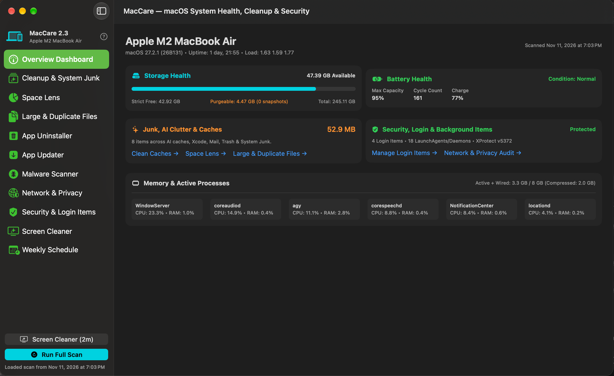
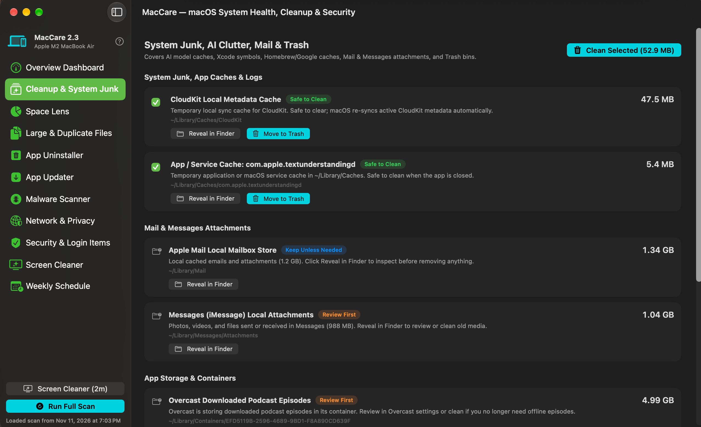

# MacCare 2.4 — Native macOS System Health, Cleanup, Uninstaller & Malware Suite

**MacCare** is a lightweight (~2.7 MB), 100% native SwiftUI macOS utility.

It performs **read-only diagnostics first**, dynamically adapts to the Mac hardware it runs on, never runs persistent background bloatware, and moves cleaned items safely to your **macOS Trash** so you always have a rollback path before emptying Trash.





---

## What's New in 2.4

- **Touch ID for privileged tasks.** On Macs equipped with a fingerprint sensor (MacBook Air, MacBook Pro, Apple Silicon Magic Keyboard with Touch ID), MacCare prompts for biometric authentication (`LocalAuthentication`) before performing privileged operations: removing system `LaunchDaemons`, uninstalling privileged helper tools, and purging protected APFS snapshots. Includes an in-app biometric toggle in Security & Login Items and status/setup helper for system-wide terminal `sudo` Touch ID via `/etc/pam.d/sudo_local`.
- **Network monitor now shows UDP.** UDP listeners and flows were silently dropped before; they now appear alongside TCP (unbound `*:*` sockets are filtered out). Parsing lives in `LsofParser.swift` with a standalone test suite.
- **Safer duplicate finder.** A fast sampled hash only picks candidates; a **full-content SHA-256** must confirm a match before any file is pre-selected for removal.
- **Safer admin uninstalls.** Items removed with administrator rights get a unique Trash name per item (no overwrites), and the result reports only moves and Login Item removals that were actually verified.
- **Honest snapshot sizing.** The purgeable-space card is labeled as an estimate.

See [Releases](https://github.com/ChipGillespie/MacCare/releases) for earlier versions.

---

## Features (11 Built-In Modules)

1. **Overview Dashboard**
   - Dynamically detects your Mac model and Apple Silicon chip (`SPHardwareDataType`), displaying a live SSD storage gauge (**Available**, **Strict Free**, and **Purgeable Space / Local Snapshots**), Battery Health (Maximum Capacity %, Cycle Count, Condition), Unified Memory breakdown, and top CPU/RAM processes.
2. **Cleanup & System Junk**
   - **Purgeable Space & Time Machine Snapshots:** Identifies APFS purgeable space and local Time Machine snapshots (`tmutil`), with options to either **keep the most recent snapshot and delete older ones** or **delete all local snapshots** to reclaim gigabytes of space immediately.
   - **AI Clutter & Intelligence Caches:** Apple Intelligence Flow caches, Visual Intelligence / Neural Engine E5 bundles, Google Gemini caches, Codex, Ollama (`~/.ollama`), and HuggingFace (`~/.cache/huggingface`).
   - **Developer & Xcode Caches:** `iOS DeviceSupport`, `CoreSimulator`, and `DerivedData`.
   - **System Junk, App Caches & Logs:** Dynamic `~/Library/Caches` scanner (CloudKit, app/service caches, Sentry crash caches), Homebrew download caches (`brew cleanup --prune=all`), Google/Chrome caches, GeoServices caches, Saved Application State, and User Logs.
   - **Mail & Messages Attachments:** Apple Mail downloaded attachments and iMessage media attachments.
   - **Trash Bins:** Inspect and empty `~/.Trash`.
3. **Space Lens — Interactive Storage Visualizer**
   - Visual proportional space breakdown bar, color-coded legend, interactive breadcrumb navigation, quick root presets (`~`, `~/Library`, `/Applications`, `~/Downloads`, `~/Projects`, or any custom directory), and 1-click folder drill-down with safe **Reveal in Finder** and **Move to Trash** actions.
4. **Large & Duplicate Files Finder**
   - **Large Files:** Scan `Downloads`, `Documents`, `Movies`, `Music`, `Pictures`, `Desktop`, and `Projects` with a configurable size filter (`> 10 MB`, `> 25 MB`, `> 100 MB`, `> 500 MB`).
   - **Exact Duplicates:** Fast two-pass size + `SHA-256` cryptographic fingerprint scanner that groups 100% identical files and automatically keeps the original unselected while selecting duplicate copies for safe removal.
5. **App Uninstaller (AppCleaner Style)**
   - Deep-scans any installed `.app` across `/Applications` and `~/Applications` to locate all associated **macOS Login Items (`System Events`)**, embedded `Contents/Library/LoginItems` helpers, `Application Support` folders, `Containers`, `Group Containers`, `Caches` (including nested crash caches), `Preferences (.plist)`, `Saved State`, `LaunchAgents`, `LaunchDaemons`, `PrivilegedHelperTools`, and `Receipts`.
   - Gracefully quits the app, removes lingering Login Items, unloads background daemons/helpers, and moves all selected items to Trash.
6. **App Updater & Version Checker**
   - Checks **Homebrew GUI Casks**, **Homebrew CLI Formulae**, and **Sparkle (`SUFeedURL`)** release feeds across `/Applications`, with 1-click update buttons.
7. **Malware Scanner (Apple XProtect YARA + Open-Source YARA + Codesign)**
   - Combines the open-source **YARA** engine (`/opt/homebrew/bin/yara`) with **Apple's official `XProtect.yara` & `XPScripts.yr` signatures** (580+ official Apple rules), **Community macOS Threat Intelligence YARA rules** (targeting modern macOS infostealers like AMOS, Poseidon, fake password prompts, and droppers), and **Apple Gatekeeper / `codesign` verification**.
   - Includes a **1-Click "Update Threat Definitions"** button to sync live cloud YARA feeds and verify XProtect updates.
8. **Network & Port Monitor • macOS Privacy Audit**
   - **Active Network & Listening Ports:** Lists all listening server ports (`LISTEN`, flagging LAN-exposed `*` / `0.0.0.0` bindings vs. localhost-only) and live outbound `ESTABLISHED` connections with full binary path resolution (`proc_pidpath`).
   - **Firewall & App Privacy Audit:** Audits the macOS Application Firewall (`socketfilterfw`), active System Extensions (`systemextensionsctl`), user TCC permissions (`TCC.db`), and app hardware/privacy capabilities across `/Applications` (Camera, Microphone, Screen Recording, Automation, Bluetooth, Location, and Disk Access), with 1-click deep links to macOS Privacy & Security settings.
9. **Security, Touch ID & Login Items Audit**
   - Verifies **System Integrity Protection (SIP)**, **Gatekeeper**, and **XProtect / XProtectPayloads** versions.
   - **Touch ID for Privileged Tasks:** Detects biometric sensor hardware (`LocalAuthentication`) on Macs with fingerprint readers (MacBook Air/Pro, Magic Keyboard with Touch ID). Prompts with native Touch ID before removing system `LaunchDaemons`, uninstalling privileged helper tools, or deleting protected APFS snapshots.
   - **System `sudo` Touch ID Integration:** Inspects `/etc/pam.d/sudo_local` and provides 1-click configuration to enable Touch ID across terminal and command-line `sudo` tools via Apple's official `pam_tid.so` PAM module.
   - Lists all **macOS Login Items** and **Background `LaunchAgents` / `LaunchDaemons`** with 1-click **"Remove Login Item"** and **"Unload & Trash"** controls so apps can't sneakily persist in the background.
10. **Screen & Keyboard Cleaner Mode**
    - Blanks all connected displays to pure black for a 2-minute countdown (or 1–5 min) and locks out accidental keyboard/trackpad presses so you can safely wipe your screen and keyboard with a cloth; press **`⌘ + Esc`** at any time to exit early.
11. **Weekly Scheduled Background Scan & Built-In Help Guide**
    - Uses a standard macOS `LaunchAgent` (`--background-scan`) that consumes **0 MB RAM** during the week, runs at your chosen day/hour, and displays native macOS Notifications when the weekly check starts and finishes.
    - Includes a built-in **MacCare Module Guide (`⌘?`)** and direct GitHub repository/issue links under the macOS **Help** menu.

---

## Requirements

- **macOS 14.0 (Sonoma) or newer** (Apple Silicon M1/M2/M3/M4)
- **Xcode Command Line Tools** (`xcode-select --install`)
- *(Optional, for Malware Scanner & Brew Updater)* **Homebrew** + **YARA**:
  ```zsh
  brew install yara
  ```

---

## Install (DMG Installer or Build from Source)

### Option A — Quick Install via `.dmg` (No Compiler Required)
1. Download **`MacCare-v2.4.dmg`** from the [**Latest GitHub Release**](https://github.com/ChipGillespie/MacCare/releases/latest).
2. Double-click `MacCare-v2.4.dmg` and drag **`MacCare.app`** into **`Applications`**.
3. On first launch on a new Mac, run `xattr -cr /Applications/MacCare.app` (or right-click `MacCare.app` → **Open**) so macOS Gatekeeper allows the ad-hoc signed bundle.

### Option B — Build from Source in 10 Seconds
Clone the repository and run `./build_app.sh` (or `./make_dmg.sh` to create a `.dmg` installer):

```zsh
git clone https://github.com/ChipGillespie/MacCare.git
cd MacCare
/bin/zsh build_app.sh

# Install into /Applications and launch:
ditto build/MacCare.app /Applications/MacCare.app
open /Applications/MacCare.app
```

---

## Project Structure

```text
MacCare/
├── Info.plist
├── build_app.sh                      # Compiles the native SwiftUI .app bundle & generates AppIcon.icns
├── make_dmg.sh                       # Packages MacCare.app + /Applications shortcut into a .dmg installer
├── make_icon.swift                   # CoreGraphics squircle icon generator
├── docs/screenshots/                 # Native SwiftUI GUI screenshots
├── Tests/
│   ├── LsofParserTests.swift         # Standalone tests for the lsof parser (canned TCP/UDP rows)
│   ├── TouchIDManagerTests.swift     # Standalone tests for Touch ID diagnostics & PAM config parsing
│   └── run_tests.sh                  # Compiles and runs the tests: ./Tests/run_tests.sh
└── Sources/
    ├── MacCareApp.swift              # App entry point, Help menu + --background-scan CLI handler
    ├── Models.swift                  # Data models for system metrics, cleanup, uninstaller & updates
    ├── TouchIDManager.swift          # LocalAuthentication Touch ID biometrics & PAM sudo integration
    ├── SystemScanner.swift           # Hardware, Battery, Purgeable/Snapshots, AI Clutter, Caches & Schedule
    ├── SpaceLensScanner.swift        # Interactive directory storage visualizer & drill-down analyzer
    ├── AppUninstaller.swift          # Deep associated-file & Login Item scanner + clean uninstaller
    ├── FileHunter.swift              # Large files & two-pass SHA-256 duplicate finder
    ├── AppUpdater.swift              # Homebrew Cask/Formula & Sparkle feed updater
    ├── MalwareScanner.swift          # YARA + Apple XProtect.yara + Community Threat Feed scanner
    ├── NetworkPrivacyMonitor.swift   # Active connections, listening ports, Firewall & TCC/Privacy audit
    ├── LsofParser.swift              # Testable lsof -i parser + TCP/UDP listener/established classification
    ├── ScreenCleanerManager.swift    # Full-screen pure-black display & keyboard cleaning mode (⌘ + Esc)
    └── ContentView.swift             # Native macOS SwiftUI NavigationSplitView interface
```

---

## License

MIT License — free to use, modify, and share.
